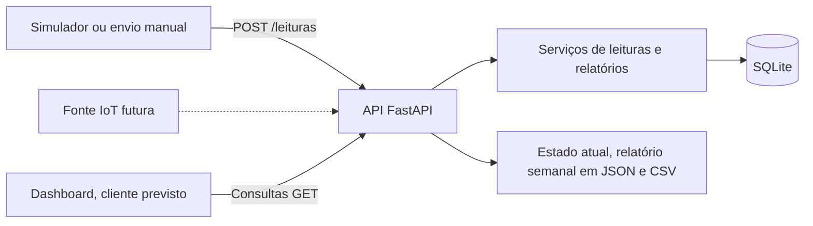

# Smart Buffet Analytics

## Apresentação

O Smart Buffet Analytics é um projeto do **Hackathon Tech FMU 2026.2** para o desafio **Bovinos Grill**. O backend recebe leituras de peso das cubas de um buffet, mostra a disponibilidade dos pratos e consolida o consumo estimado e os eventos de alerta em um relatório semanal.

## Problema

A equipe de um buffet precisa acompanhar quanto ainda há de cada alimento e quais cubas estão próximas de acabar. Verificações manuais ajudam na reposição imediata, mas dificultam a comparação do consumo entre pratos e dias.

## Solução proposta

Cada leitura associa uma balança, um prato e um peso. A API calcula a disponibilidade da cuba, sinaliza a entrada em estado crítico e armazena as leituras para consulta posterior. O relatório semanal resume o consumo por prato e por dia e pode ser baixado como CSV.

O MVP pode ser demonstrado com pesos simulados, enviados por um cliente HTTP ou pelo Swagger. Uma fonte futura com ESP32 e sensores de peso poderá enviar leituras pelo mesmo endpoint.

## Funcionalidades

- Registro e validação de leituras para até cinco balanças.
- Estado atual com a última leitura de cada balança monitorada e os totais de balanças monitoradas e críticas.
- Histórico de leituras no SQLite, com consumo estimado e registro de novos alertas.
- Relatório semanal em JSON com totais, consumo diário e ranking por prato.
- Exportação CSV e documentação interativa da API com Swagger e ReDoc.

## Tecnologias

| Tecnologia | Uso |
| --- | --- |
| Python e Uvicorn | Execução do backend e servidor ASGI. |
| FastAPI e Pydantic v2 | Rotas HTTP, validação, contratos e OpenAPI. |
| SQLite via `sqlite3` | Armazenamento local das leituras. |
| `zoneinfo` e `tzdata` | Conversão entre UTC e o calendário de São Paulo. |
| pytest, TestClient e HTTPX | Testes de regras, contratos e integração. |

## Arquitetura



Veja o [documento de arquitetura](docs/architecture.md) para o modelo de dados e os fluxos de execução.

## Estrutura de pastas

```text
.
├── app/
│   ├── main.py
│   ├── database/
│   │   ├── database.py
│   │   ├── queries.py
│   │   └── schema.sql
│   ├── routers/
│   │   ├── leitura_router.py
│   │   └── relatorio_router.py
│   ├── schemas/
│   │   ├── leitura_schema.py
│   │   └── relatorio_schema.py
│   ├── services/
│   │   ├── leitura_service.py
│   │   └── relatorio_service.py
│   └── utils/
│       ├── constants.py
│       └── normalizacao.py
├── docs/
│   ├── api-integration.md
│   ├── architecture.md
│   └── demo-guide.md
├── tests/
│   ├── test_api.py
│   ├── test_integracao.py
│   ├── test_leituras.py
│   ├── test_limites_sqlite.py
│   ├── test_relatorio.py
│   └── test_schemas.py
├── .gitignore
├── AGENTS.md
├── README.md
└── requirements.txt
```

## Pré-requisitos

- Python 3.15, validado com a versão 3.15.2, com `pip` e `venv`.
- Git para clonar o repositório.
- Dependências fixadas em [requirements.txt](requirements.txt). O SQLite é fornecido pela biblioteca padrão do Python.

## Instalação

Clone a branch de backend e acesse a pasta. Use uma revisão de entrega que inclua o schema SQLite preenchido, o módulo `app/utils/normalizacao.py` e `tzdata` em `requirements.txt`.

```shell
git clone --branch feature/backend https://github.com/FernandoKooji/projeto-hakathon-FMU-2026.2-
cd projeto-hakathon-FMU-2026.2-
python -m venv .venv
```

No PowerShell, ative o ambiente com este comando.

```powershell
.\.venv\Scripts\Activate.ps1
```

Se o PowerShell bloquear o script de ativação, substitua `python` por `.\.venv\Scripts\python.exe` nos comandos de instalação, execução e testes.

No Linux ou macOS, use este comando.

```shell
source .venv/bin/activate
```

Instale as dependências no ambiente ativo.

```shell
python -m pip install -r requirements.txt
```

## Execução

Execute o Uvicorn na raiz do repositório.

```shell
python -m uvicorn app.main:app --host 127.0.0.1 --port 8000
```

O FastAPI cria `app/database/database.db` automaticamente na primeira inicialização e reaproveita os dados nas seguintes. Para uma série de testes manuais com banco vazio, use o [roteiro de demonstração](docs/demo-guide.md).

- [URL base da API](http://127.0.0.1:8000)
- [Swagger UI](http://127.0.0.1:8000/docs)
- [ReDoc](http://127.0.0.1:8000/redoc)

## Endpoints

| Método e rota | Finalidade | Códigos HTTP |
| --- | --- | --- |
| `GET /` | Identifica o projeto. | `200` |
| `GET /health` | Verifica a disponibilidade do serviço HTTP. | `200` |
| `POST /leituras` | Valida e registra uma leitura. | `201` criada, `409` fora de ordem, `422` inválida |
| `GET /estado-atual` | Retorna a última leitura de cada balança com dados. | `200` |
| `GET /relatorio-semanal` | Retorna o resumo semanal em JSON. | `200` |
| `GET /relatorio-semanal/csv` | Baixa o resumo semanal em CSV. | `200` |
| `GET /openapi.json` | Retorna a especificação OpenAPI. | `200` |

O [guia de integração](docs/api-integration.md) detalha os payloads, as respostas, o CORS e o download via JavaScript.

## Regras de negócio

- A capacidade padrão é de **4.000 g**. O peso deve estar entre zero e a capacidade informada, que precisa ser positiva.
- O percentual é calculado com `peso_atual_g / capacidade_max_g × 100`. O status usa o valor antes do arredondamento para exibição.

| Disponibilidade | Status |
| --- | --- |
| Menor que 25% | `ACABANDO` |
| A partir de 25% e abaixo de 50% | `ATENCAO` |
| A partir de 50% | `OK` |

- O consumo estimado é a redução de peso entre leituras consecutivas da mesma balança e do mesmo prato. Peso inalterado ou aumento por reposição tem consumo zero.
- A primeira leitura e a troca de prato definem uma nova referência com consumo zero. A comparação de nomes ignora diferenças de maiúsculas, minúsculas e representações Unicode equivalentes.
- Um novo alerta é contado ao entrar em `ACABANDO`, inclusive na primeira leitura ou após trocar de prato. Leituras críticas consecutivas do mesmo prato não somam novos eventos.
- As leituras devem chegar em ordem cronológica por balança. Um instante anterior retorna `409`. Se os timestamps forem iguais, o ID resolve o empate.
- O relatório cobre o dia atual e os seis anteriores em `America/Sao_Paulo`. As leituras são armazenadas em UTC e agrupadas pelo dia local.

## Testes automatizados

```shell
python -m pytest -v
python -m pytest -q
```

Os testes que acessam o SQLite usam bancos em diretórios temporários. A validação da Etapa 14 executou **122 testes com sucesso**.

## Demonstração

1. Inicie o backend e abra o Swagger.
2. Registre uma leitura de Arroz em uma balança com capacidade de 4.000 g.
3. Envie pesos decrescentes e consulte `GET /estado-atual`.
4. Reduza o peso abaixo de 25% para observar `ACABANDO` e um novo alerta.
5. Envie uma reposição, confira a mudança de status e consulte o relatório semanal.
6. Baixe o CSV e compare o consumo e os alertas com o relatório JSON.

O [roteiro completo](docs/demo-guide.md) inclui um banco isolado, payloads copiáveis e resultados esperados.

## Limitações do MVP

- O consumo é uma estimativa de retirada da cuba. Reduções podem incluir desperdício ou retirada operacional, além do alimento servido.
- A API funciona sem autenticação. O CORS está configurado para origens locais de desenvolvimento.
- A demonstração usa dados simulados. Uma implantação com hardware físico exigirá calibração, tara e validação das medições.
- A ordem cronológica é obrigatória por balança. O relatório cobre uma janela fixa e não oferece filtros.
- O SQLite permite leituras concorrentes em modo WAL, mas serializa as escritas. Os testes exercitam a concorrência esperada no MVP.

## Evoluções futuras

- Integração física com ESP32 e sensores de peso.
- Calibração automática.
- Integração com registros de venda.
- Indicadores de desperdício.
- Previsão de demanda.
- Monitoramento de múltiplas unidades de restaurante.

## Equipe

| Integrante | Responsabilidade |
| --- | --- |
| Integrante 1 | Simulador e geração de dados. |
| Integrante 2 | Backend, banco de dados e relatórios. |
| Integrante 3 | Dashboard e visualização. |


## Contexto do desafio e fluxo da equipe

Descrição do Problema

No self-service de uma churrascaria como o --Bovinos Grill--, o controle dos acompanhamentos nas cubas  costuma ser feito no olho ou por inspeção visual esporádica. Esse modelo gera dois problemas diretos na operação:

* Ruptura sem aviso e filas: quando um prato acaba de repente e a cozinha só percebe depois que a cuba esvazia, o fluxo de atendimento trava e o cliente espera mais do que o necessário.
* Desperdício e falta de previsibilidade: sem histórico confiável de saída por prato, a equipe tende a produzir em excesso por precaução — gerando sobras no fim do turno — ou a planejar compras e preparos semanais no achismo.

---

 Solução Proposta

A solução é um sistema de telemetria operacional e relatório semanal  para as 5 posições do buffet, desenhado para funcionar hoje com dados inseridos/simulados manualmente e escalar depois para balanças ou módulos com ESP32:

* Leitura contínua por posição   cada posição registra o peso atual do prato, permite alterar o nome do prato do dia e classifica o nível em `OK` (a partir de 50%), `ATENCAO` (entre 25% e 50%) ou `ACABANDO` (abaixo de 25%).
* Aviso de reposição na cozinha: quando o nível cai abaixo de 25%, o painel destaca o prato em estado crítico para orientar a reposição antes que acabe.
* Relatório semanal consolidado: as quedas de peso entre leituras são contabilizadas como consumo, gerando um resumo dos últimos 7 dias com o total consumido por prato e quantas vezes cada item entrou em `ACABANDO`.
* Compatibilidade com hardware futuro: todas as leituras passam pela mesma entrada (`POST /leituras`), permitindo plugar uma zalança ou ESP32 no futuro sem alterar o painel ou o relatório, e sem exigir balança fiscal (por se tratar de controle interno, não de cobrança no caixa).

---

  Detalhamento e Desenvolvimento do Projeto

  1. Divisão do Trabalho Entre os 3 Integrantes

* Integrante 1 (Você — Entrada de Dados / Simulador): cria a ferramenta para inserir pesos das posições, trocar o nome do prato, simular quedas até abaixo de 25%, simular reposição e gerar leituras de teste para o relatório semanal.
* Integrante 2 (Backend & Relatório Semanal): implementa o recebimento das leituras, o cálculo de status e consumo, a persistência no banco e os dados do estado atual e do relatório dos últimos 7 dias.
* Integrante 3 (Dashboard & Avisos): monta o painel com atualização automática, o destaque visual de pratos em `ACABANDO` e a visão do relatório semanal com opção de copiar ou baixar o resumo.

  2. Fluxo de Desenvolvimento e Integração

1. Padronização inicial: alinhar os campos de envio de leitura (`balanca_id`, `prato`, `peso_atual_g`, `capacidade_max_g`, `origem`) e as rotas antes de codar em paralelo.
2. Núcleo em tempo real: subir o envio de leituras, o cálculo de status e o painel exibindo as 5 posições e os avisos abaixo de 25%.
3. Ciclo de reposição e relatório: testar a subida de peso na reposição (sem contar como consumo) e validar o consolidado semanal com dados de teste.
4. Refinamento e consistência: tratar valores inválidos (como peso negativo ou acima da capacidade máxima) e conferir se o painel reflete as mudanças sem travar.
