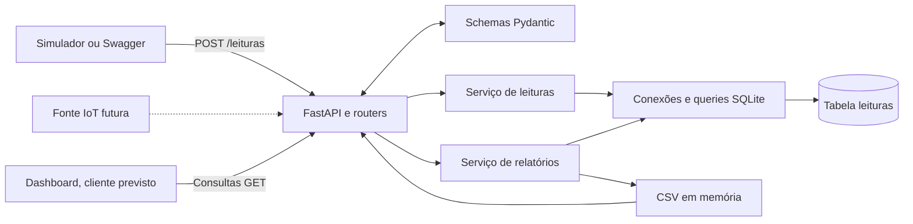

# Arquitetura do backend

O Smart Buffet Analytics recebe leituras de peso, calcula a disponibilidade por cuba e registra o consumo estimado. O estado atual, o relatório semanal em JSON e o download CSV são expostos pela API FastAPI para consumo por clientes HTTP. A demonstração pode enviar dados pelo Swagger. Simulador, dashboard e fonte IoT são clientes previstos para a integração.

## Componentes

| Componente | Responsabilidade |
| --- | --- |
| `app/main.py` | Configura CORS, registra os routers e inicializa o banco no ciclo de vida da API. |
| `app/routers/` | Expõe os endpoints síncronos, encaminha chamadas aos serviços e define as respostas HTTP. |
| `app/schemas/` | Valida as leituras recebidas e define os contratos de saída. |
| `app/services/` | Calcula disponibilidade, consumo, alertas e agregações do relatório. |
| `app/database/` | Inicializa o SQLite, abre conexões e mantém o SQL parametrizado. |
| `app/utils/` | Define constantes e uma chave de comparação de nomes usando NFC e `casefold()`. |

## Registro de uma leitura

1. `POST /leituras` valida balança, prato, peso, capacidade, origem e timestamp. Dados inválidos retornam `422`.
2. O serviço abre uma conexão e inicia `BEGIN IMMEDIATE` antes de consultar a última leitura da balança, ordenada por `criado_em DESC, id DESC`.
3. O serviço rejeita um timestamp anterior ao último da balança. O router traduz o conflito para `409`. Timestamps iguais são aceitos.
4. O serviço usa a última leitura da balança como referência quando o prato continua o mesmo. Calcula o consumo, determina o status pelo percentual e identifica um novo evento de alerta. A primeira leitura e a troca de prato reiniciam a referência de consumo e alerta.
5. A nova leitura é inserida e recuperada pelo ID. O serviço valida a resposta antes de confirmar a transação. Em caso de erro, executa rollback. A conexão é fechada ao concluir a operação.

A transação engloba a leitura anterior e a nova inserção. Isso permite que escritas concorrentes na mesma balança usem como referência a última leitura confirmada.

## Consulta do estado atual

`GET /estado-atual` usa `ROW_NUMBER()` para selecionar a última leitura de cada balança. O serviço recalcula o percentual a partir dos pesos, mantém o status persistido e retorna as balanças por ID crescente. `total_monitoradas` conta as balanças com leituras e `total_acabando` conta as que estão no estado `ACABANDO`. O banco vazio retorna lista vazia e totais zero.

## Geração do relatório semanal

1. O serviço calcula sete dias de calendário em `America/Sao_Paulo`. Converte para UTC a meia-noite do primeiro dia e a meia-noite após o último dia.
2. O SQLite recupera as linhas no intervalo `[início, fim)`. A query agrupa registros com o mesmo nome, timestamp e consumo e soma os eventos de alerta de cada grupo.
3. O serviço converte cada timestamp para a data local e acumula gramas por prato e dia. Usa a grafia da primeira leitura do grupo no período para exibição e preenche os dias sem consumo com zero.
4. O resultado é ordenado por consumo decrescente, com desempate pelo nome normalizado. A API oferece o mesmo cálculo em JSON e CSV. Cada chamada consulta o banco no momento em que é feita.

A exportação gera o CSV em memória, com UTF-8 com BOM, delimitador ponto e vírgula, vírgula decimal e proteção de células de texto que poderiam ser interpretadas como fórmulas.

## Armazenamento SQLite

O lifespan lê `schema.sql` e cria a tabela e os índices quando necessário. O caminho padrão é `app/database/database.db`. O arquivo local fica fora do Git. O banco opera em modo WAL, com uma conexão por operação e espera de até dez segundos por bloqueios. As escritas são serializadas pelo SQLite.

### Tabela leituras

| Coluna | Tipo | Significado |
| --- | --- | --- |
| `id` | INTEGER | Chave primária autoincrementada, usada para desempatar timestamps iguais. |
| `balanca_id` | INTEGER | Identificador da balança, de 1 a 5. |
| `prato` | TEXT | Nome do prato usado na apresentação. |
| `peso_atual_g` | INTEGER | Peso de zero até a capacidade configurada. |
| `capacidade_max_g` | INTEGER | Capacidade positiva, com padrão de 4.000 g. |
| `consumo_g` | INTEGER | Consumo estimado da leitura, com padrão zero. |
| `status` | TEXT | `OK`, `ATENCAO` ou `ACABANDO`. |
| `novo_alerta` | INTEGER | Evento de alerta, representado por `0` ou `1`. |
| `origem` | TEXT | `simulador`, `manual` ou `esp32`, com padrão `simulador`. |
| `criado_em` | TEXT | Instante em ISO 8601, com microssegundos e offset UTC. |

Há índices por balança, data e prato. O serviço calcula o percentual a partir de peso e capacidade e o inclui nas respostas de leitura e estado atual.

### Timestamps

Timestamps recebidos devem informar fuso e ser no máximo o instante atual. Quando omitidos ou enviados como `null`, recebem o horário UTC do servidor após o início da transação. A gravação usa ISO 8601 com seis casas decimais e offset `+00:00`, permitindo ordenar e filtrar o texto no SQLite. O relatório converte para o calendário de São Paulo na consulta. O pacote `tzdata` fornece a base de fusos em ambientes como Windows.

## Testes

O pytest cobre schemas, regras de negócio, endpoints, CORS, relatório e CSV. O TestClient executa o lifespan com um caminho SQLite temporário definido antes do startup. Os testes de integração usam datas fixas e conferem escrita concorrente, rollback, reinicialização e a correspondência entre JSON e CSV.

## Decisões e limites do MVP

- A rota de ingestão atende diferentes origens pelo mesmo contrato. A origem `esp32` é um valor aceito para uma futura fonte física.
- O consumo é calculado no registro da leitura e usado nas agregações semanais. Ele estima retirada de alimento da cuba e pode incluir desperdício ou retirada operacional.
- O backend é local, sem autenticação, e o CORS permite origens de desenvolvimento específicas.
- O SQLite atende à carga de demonstração. Escritas concorrentes disputam o mesmo banco e operações que excedam a espera por bloqueio podem falhar.
- O relatório tem período fixo e cada consulta lê o histórico disponível naquele momento. O CSV contém o resumo por prato.
